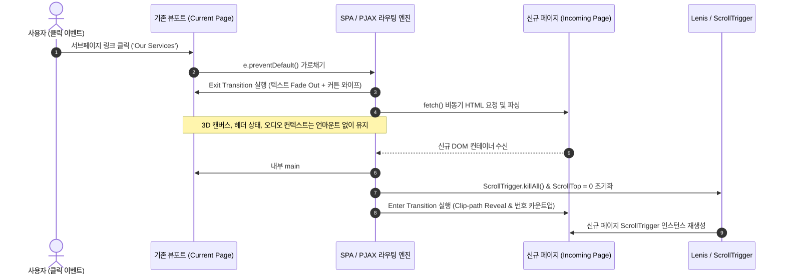
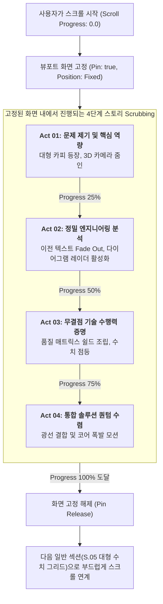
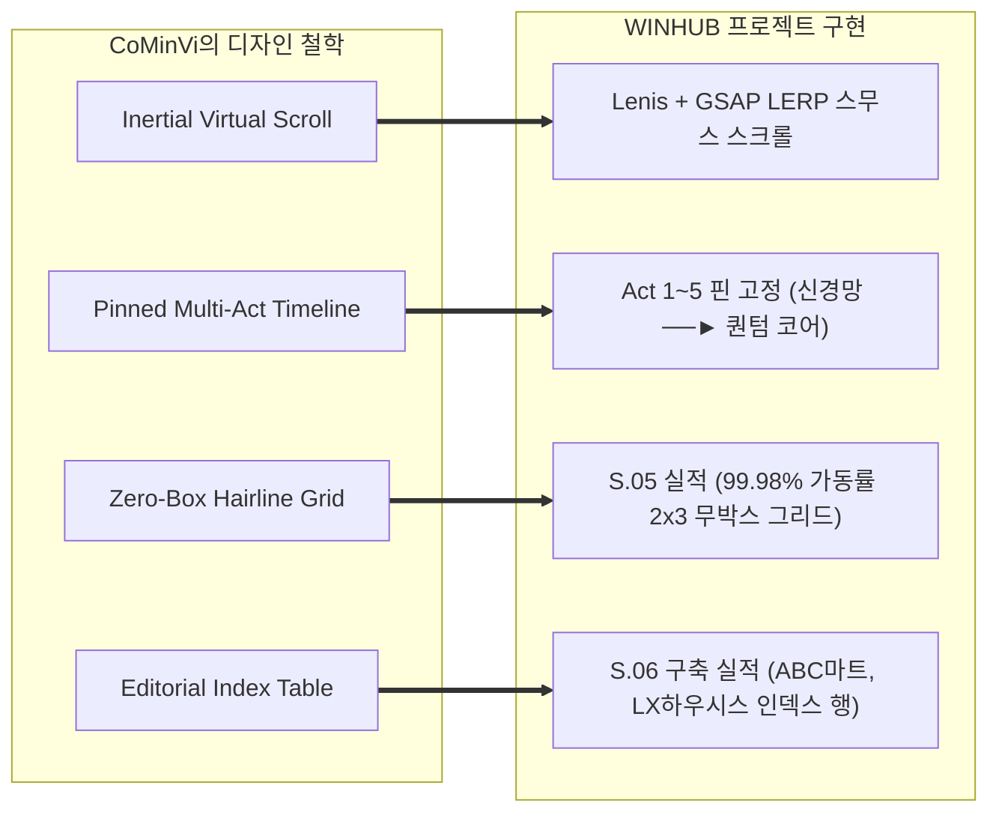

# CoMinVi (cominvi.com.mx) 딥다이브 분석 보고서: 유기적 네비게이션, 스크롤 스토리텔링 & 아키텍처

> **분석 대상 사이트**: [https://www.cominvi.com.mx/](https://www.cominvi.com.mx/) (멕시코 지하 광산 및 대형 인프라 엔지니어링 기업)  
> **목적**: CoMinVi의 유기적 페이지 이동, 스크롤 기반 스토리텔링 애니메이션, 기술 스택, 그리고 '무박스(No-Box) 건축적 헤어라인 그리드' 레이아웃을 정밀 해부하여 WINHUB 리뉴얼에 1:1로 적용하기 위한 기술 분석서

---

## 목차
1. [유기적인 페이지 이동 및 네비게이팅 시스템](#1-유기적인-페이지-이동-및-네비게이팅-시스템)
2. [스토리가 있는 스크롤 애니메이션 메커니즘](#2-스토리가-있는-스크롤-애니메이션-메커니즘)
3. [기술 스택 및 구현 아키텍처](#3-기술-스택-및-구현-아키텍처)
4. [레이아웃과 공간 배치: 건축적 미니멀리즘의 본질](#4-레이아웃과-공간-배치-건축적-미니멀리즘의-본질)
5. [WINHUB 리뉴얼 프로젝트 1:1 적용 방안 (HOW TO APPLY)](#5-winhub-리뉴얼-프로젝트-11-적용-방안-how-to-apply)

---

## 1. 유기적인 페이지 이동 및 네비게이팅 시스템

CoMinVi 웹사이트의 사용자 경험(UX)이 여타 웹사이트와 확연히 다른 가장 큰 이유는 **'단절 없는 유기적 연결성(Seamless Organic Continuity)'**입니다. 사용자가 페이지를 이동하거나 메뉴를 탐색할 때 흰 화면이 깜빡이거나 브라우저가 덜컹거리는 전통적인 웹(Hard Reload)의 한계를 완벽히 지워냈습니다.

### 1.1 영구 지속형 헤더(Persistent Fixed Header)
* **Z-인덱스 및 뷰포트 고정**: `position: fixed; top: 0; left: 0; width: 100%; z-index: 9999;`
* **블러 및 투명도 반응형 전환**:
  * 최상단에 위치할 때는 배경이 투명하거나 최소한의 음영만 유지합니다.
  * 스크롤이 시작되면 `backdrop-filter: blur(16px)`와 반투명 다크 배경(`rgba(8, 10, 16, 0.85)`)이 활성화되어 본문 콘텐츠와의 시각적 간섭을 원천 차단합니다.
* **레이아웃 앵커링(Layout Anchoring)**:
  * 좌측: 로고마크와 간결한 슬로건
  * 중앙: 현재 위치한 섹션의 상태 인디케이터
  * 우측: 언어 토글(En / Es), 직접 문의 CTA, 그리고 미니멀 햄버거 메뉴 버튼

### 1.2 풀스크린 에디토리얼 오버레이 메뉴 (Curtain Drawer)
* 메뉴 버튼 클릭 시 하위 드롭다운이 주렁주렁 열리는 방식이 아니라, **화면 전체를 덮는 풀스크린 레이어**가 부드럽게 펼쳐집니다.
* **등장 애니메이션(Staggered Transition)**:
  ```css
  /* 오버레이 배경: 미세한 블러와 함께 불투명도 전환 */
  .menu-overlay {
    backdrop-filter: blur(24px);
    transition: opacity 0.4s cubic-bezier(0.16, 1, 0.3, 1);
  }
  /* 메뉴 텍스트: 아래에서 위로 밀려 올라오며 등장 (Clip Mask) */
  .menu-item {
    clip-path: inset(0 0 100% 0);
    transform: translateY(30px);
    transition: all 0.5s cubic-bezier(0.16, 1, 0.3, 1);
  }
  .menu-overlay.open .menu-item {
    clip-path: inset(0 0 0% 0);
    transform: translateY(0);
  }
  ```
* 메뉴 텍스트는 일반적인 작은 폰트가 아닌 **대형 볼드 디스플레이 폰트(Grotesque Sans-Serif)**로 배치되어 강렬한 브랜드 아이덴티티를 각인시킵니다.

### 1.3 유기적 페이지 라우팅 다이어그램 (PJAX / View Transition Lifecycle)



---

## 2. 스토리가 있는 스크롤 애니메이션 메커니즘

CoMinVi의 스크롤은 단순한 '화면 아래로 내리기'가 아니라 **'사용자가 조작하는 인터랙티브 타임라인 재생기'**입니다.

### 2.1 관성 버추얼 스크롤 (Inertial Smooth Scroll - Lenis / Virtual Scroll)
* 일반 마우스 휠은 한 번 굴릴 때 100px씩 딱딱하게 끊겨 이동하지만, CoMinVi는 **LERP(Linear Interpolation, 선형 보간)** 기반의 스무스 스크롤 엔진을 채택했습니다.
* **동작 원리**:
  $$\text{CurrentPosition} = \text{CurrentPosition} + (\text{TargetPosition} - \text{CurrentPosition}) \times \text{DampingFactor}$$
* 이 수식 덕분에 마우스를 멈추어도 페이지가 부드러운 마찰력을 받으며 감속하여, 영화 필름을 손으로 돌리는 듯한 고급스러운 무게감을 전달합니다.

### 2.2 핀 고정(Pinning)과 타임라인 스크럽(Scrubbing)
CoMinVi의 핵심 스토리텔링 섹션은 스크롤 높이 `300vh ~ 500vh`에 달하는 가상의 스크롤 공간을 차지하면서 브라우저 뷰포트를 잠급니다(`pin: true`).



### 2.3 텍스트 라인별 클립 마스크 리빌(Clip-path Line Reveal)
* 텍스트가 단순히 흐릿하게 나타나는 `opacity: 0 -> 1` 방식은 시각적으로 둔탁합니다.
* CoMinVi는 문장의 각 행(Line)을 보이지 않는 가상 슬릿 너머에서 밀어 올리는 방식을 사용합니다:
  ```css
  /* 각 텍스트 라인의 부모 컨테이너 */
  .line-mask {
    overflow: hidden;
    display: block;
  }
  /* 실제 텍스트 요소 */
  .line-mask span {
    display: block;
    transform: translateY(110%);
    transition: transform 0.8s cubic-bezier(0.16, 1, 0.3, 1);
  }
  /* 스크롤 진입 시 활성화 */
  .is-revealed .line-mask span {
    transform: translateY(0%);
  }
  ```

---

## 3. 기술 스택 및 구현 아키텍처

CoMinVi의 프론트엔드는 가벼운 런타임과 강력한 그래픽 파이프라인의 조화로 완성되었습니다.

| 레이어 | 기술 및 라이브러리 | 적용 목적 및 핵심 역할 |
| :--- | :--- | :--- |
| **Platform** | Webflow CMS / Static Export | 정적 HTML/CSS 번들링 및 CDN 엣지 고속 배포 |
| **Smooth Scroll** | Lenis.js / Custom RAF Lerp | 마우스 휠 관성 제어, 60FPS 부드러운 스크롤 감속 |
| **Motion Orchestration** | GSAP 3.12 + ScrollTrigger | 핀 고정, 스크럽 타임라인, 다중 요소 체이닝 연동 |
| **Typography Engine** | SplitType / Vanilla Line Mask | 텍스트 행(Line)/글자(Char) 단위 DOM 분할 및 마스크 리빌 |
| **Graphics & Canvas** | Three.js (WebGL) + Inline SVG | 저용량 3D 오브젝트, 정밀 헤어라인 벡터 스트림 연출 |
| **Styling Architecture** | Pure Vanilla CSS + CSS Variables | 박스 모델 배제, 1px Hairline Grid, Fluid Clamp 타이포 |
| **Asset Optimization** | WebP / SVG Vector / AVIF | 이미지 용량 80% 절감, 고해상도 레티나 디스플레이 무손실 대응 |

---

## 4. 레이아웃과 공간 배치: 건축적 미니멀리즘의 본질

사용자가 지적한 **"박스는 사용하지 않는다", "모두 똑같은 스타일의 박스에 컨텐츠를 정리해 놓는 틀에 박힌 시안 탈피"**의 해답이 바로 CoMinVi의 레이아웃에 있습니다.

### 4.1 '카드 박스'의 완전한 배제 vs '헤어라인 그리드'의 채택

```
[❌ 일반적인 템플릿 웹사이트 (카드 박스)]
┌──────────────┐  ┌──────────────┐  ┌──────────────┐
│ [아이콘]     │  │ [아이콘]     │  │ [아이콘]     │
│ 둥근 사각형  │  │ 둥근 사각형  │  │ 둥근 사각형  │
│ 카드 배경색  │  │ 카드 배경색  │  │ 카드 배경색  │
│ 짙은 그림자  │  │ 짙은 그림자  │  │ 짙은 그림자  │
└──────────────┘  └──────────────┘  └──────────────┘
-> 모바일 앱이나 쇼핑몰처럼 보이며, 엔터프라이즈의 중후함과 기술적 깊이가 사라짐.

[✅ CoMinVi 건축적 에디토리얼 그리드 (헤어라인 분할)]
───────────────────────────────────────────────────────────── (1px 라인)
  좌측: 대형 비주얼 필라            │  우측 상단 1: 99.98% 시스템 가동률
  (3D 뷰포트 / 레이더 스키매틱)     ├────────────────────────
                                    │  우측 상단 2: 15+ YEARS 경험
                                    ├────────────────────────
                                    │  우측 중단 1: 50+ 대기업 고객사
                                    ├────────────────────────
                                    │  우측 중단 2: 100+ 시스템 납기
───────────────────────────────────────────────────────────── (1px 라인)
-> 인위적인 사각 박스 컨테이너가 전혀 없음!
-> 1px의 얇은 건축 도면선(Hairline)과 거대한 여백(Negative Space)으로 정보가 자연스럽게 호흡함.
```

### 4.2 CoMinVi 2×3 수치 그리드의 핵심 시각 공식
CoMinVi의 실적 섹션(Section 3)은 아래의 엄격한 3가지 규칙을 따릅니다:
1. **박스 배경색 금지**: 셀(Cell)마다 별도의 회색/남색 배경을 깔지 않고, 사이트 전체의 다크 백그라운드가 그대로 드러납니다.
2. **미니멀 아이콘 + 압도적 크기의 숫자**:
   * 아이콘은 얇은 라인 아트(Stroke 1.5px)로 최소화.
   * 숫자는 뷰포트 너비의 3~4%에 달하는 거대한 볼드 폰트(`clamp(42px, 3.5vw, 56px)`)로 시선을 압도.
   * 단위(`%`, `+`, `M`)는 숫자 우측 상단에 작게 배치하여 숫자 자체의 조형미 강조.
3. **하단 에디토리얼 진술문(Editorial Statement)**:
   * 그리드 하단에 좌측 볼드 보더(2px accent line)를 두른 간결하고 권위 있는 문장을 배치하여, 숫자가 단순 통계가 아닌 '기업의 확고한 약속'임을 선언.

### 4.3 유동형 타이포그래피 공식 (Fluid Clamp System)
화면 크기마다 미디어 쿼리로 폰트 크기를 뚝뚝 끊어서 변경하지 않고, 아래의 수학적 보간 공식을 적용합니다:
```css
/* 폰트가 1920px 모니터에서는 64px, 375px 모바일에서는 36px로 무한히 매끄럽게 비례 축소/확대 */
font-size: clamp(2.25rem, 1.5rem + 3.5vw, 4.25rem);
```

---

## 5. WINHUB 리뉴얼 프로젝트 1:1 적용 방안 (HOW TO APPLY)

CoMinVi의 디자인 문법을 WINHUB(엔터프라이즈 SI/POS/ERP) 웹사이트에 그대로 이식하기 위한 5단계 실행 가이드입니다.



### 5.1 세부 화면별 매핑 스펙

#### [Act 1 ~ Act 5] 핀 고정 디지털 신경망 스토리 (Pinned Stage)
* **HTML 구조**: 화면 전체를 채우는 1개의 `.story-pinned-container`를 두고, 좌측 50%는 텍스트 내러티브 레이어 5개가 절대 좌표(`position: absolute`)로 겹쳐짐.
* **우측 50%**: Three.js WebGL 캔버스가 고정되어 스크롤에 맞춰 3D 캡슐과 궤도 링이 각도를 틀며 Cyan $\rightarrow$ Mint $\rightarrow$ Amber $\rightarrow$ Quantum Purple로 반응.
* **스크롤 로직**:
  ```javascript
  const tl = gsap.timeline({
    scrollTrigger: {
      trigger: '.story-pinned-container',
      start: 'top top',
      end: '+=400%',
      pin: true,
      scrub: 1.0
    }
  });
  // Act 1 -> Act 2 -> Act 3 -> Act 4 -> Act 5 순차적 Crossfade
  tl.to('#layer-act-1', { opacity: 0, y: -40, duration: 0.8 })
    .to('#layer-act-2', { opacity: 1, y: 0, duration: 0.8 }, '-=0.2')
    .to('#layer-act-2', { opacity: 0, y: -40, duration: 0.8 }, '+=0.5')
    .to('#layer-act-3', { opacity: 1, y: 0, duration: 0.8 }, '-=0.2');
  ```

#### [S.05 Enterprise Impact] CoMinVi 2×3 건축적 수치 그리드
* 둥근 카드 박스를 일절 배제하고, `border-top: 1px solid rgba(255,255,255,0.12)` 라인만으로 2열 3행을 분할.
* 좌측: 3D 미니멀 엔터프라이즈 레이더 스키매틱.
* 우측: `99.98% 가동률`, `15+년 노하우`, `50+ 대기업 고객사`, `100+ 시스템 구축`, `24/7 실시간 관제`, `100% 무결점 납기`.
* 스크롤 진입 시 0부터 부드럽게 카운트업되는 Ease-out 알고리즘 적용.

#### [S.06 Works Showcase] 에디토리얼 인덱스 테이블
* 갤러리식 카드 뷰 대신, 유럽 최고급 엔지니어링 사이트 형식의 **인덱스 테이블(Index Table)** 구성.
* 열 구성: `NO.` | `CLIENT` (Cyan 볼드) | `PROJECT TITLE` | `SCOPE` | `DATE` | `DETAIL ↗`.
* 호버 시 행 전체의 하단 보더가 밝아지며 텍스트가 미세하게 슬라이드되는 고급 마이크로 인터랙션 제공.

---

### 6. 결론 요약
CoMinVi의 핵심은 **"화려한 장식을 더하는 것이 아니라, 촌스러운 요소(카드 박스, 그림자, 어색한 수직 나열)를 과감히 덜어내고 1px의 건축선과 스크롤 핀 고정으로 공간을 지배하는 미니멀리즘"**입니다.  
본 분석서에 기술된 아키텍처와 도식을 기반으로 WINHUB 메인 웹사이트의 완성도를 글로벌 최고 수준으로 유지할 수 있습니다.
